# Dimensional Model

## Logical Star Schema

```mermaid
erDiagram
    DIM_DATE ||--o{ FACT_TRANSACTION : dates
    DIM_ACCOUNT ||--o{ FACT_TRANSACTION : contains
    DIM_CUSTOMER ||--o{ FACT_TRANSACTION : owns
    DIM_BRANCH ||--o{ FACT_TRANSACTION : occurs_at
    DIM_CURRENCY ||--o{ FACT_TRANSACTION : uses
    DIM_DATE ||--o{ FACT_EXCHANGE_RATE : dates
    DIM_CURRENCY ||--o{ FACT_EXCHANGE_RATE : quotes
    DIM_CUSTOMER ||--o{ FACT_LOAN : borrows
    DIM_ACCOUNT ||--o{ FACT_LOAN : secures
    DIM_DATE ||--o{ FACT_LOAN : starts
    DIM_DATE ||--o{ FACT_LOAN : ends
    FACT_LOAN ||--o{ FACT_LOAN_PAYMENT : receives
    DIM_DATE ||--o{ FACT_LOAN_PAYMENT : dates
    DIM_CUSTOMER ||--o{ FACT_LOAN_APPLICATION : applies
    DIM_LOAN_PRODUCT ||--o{ FACT_LOAN_APPLICATION : requests
    DIM_LOAN_OFFICER ||--o{ FACT_LOAN_APPLICATION : assigned
    DIM_DATE ||--o{ FACT_LOAN_APPLICATION : submitted
    FACT_LOAN ||--o{ FACT_LOAN_DISBURSEMENT : disbursed
    DIM_LOAN_OFFICER ||--o{ FACT_LOAN_DISBURSEMENT : authorized
    FACT_LOAN ||--o{ FACT_LOAN_REPAYMENT_SCHEDULE : scheduled
    FACT_LOAN ||--o{ FACT_LOAN_COLLATERAL : secured_by
    FACT_LOAN ||--o{ FACT_LOAN_GUARANTOR : guaranteed_by
    FACT_LOAN ||--o{ FACT_LOAN_FEE : assessed
    FACT_LOAN ||--o{ FACT_LOAN_RECOVERY_ACTION : recovered
    DIM_LOAN_OFFICER ||--o{ FACT_LOAN_RECOVERY_ACTION : performs
    FACT_LOAN ||--o{ FACT_LOAN_AUDIT : changed
    FACT_LOAN ||--o{ FACT_LOAN_PAYMENT_AUDIT : payment_changed
```

## Physical Schema

### Dimensions

| Table | Primary key | Important attributes |
| --- | --- | --- |
| `dim_date` | `date_key` | `full_date`, year, quarter, month, week |
| `dim_currency` | `currency_key` | `currency_code`, reporting flag |
| `dim_branch` | `branch_key` | source branch ID, name, city, province |
| `dim_customer` | `customer_key` | source customer ID, name, gender, DOB, occupation |
| `dim_account` | `account_key` | source account ID, customer, branch, type, balance |
| `dim_loan_product` | `product_key` | source product ID, code, category, loan limits and pricing |
| `dim_loan_officer` | `officer_key` | source officer ID, employee code, branch, role, status |

### Facts

| Table | Grain | Measures |
| --- | --- | --- |
| `fact_transaction` | One banking transaction | `amount`, `lkr_amount` |
| `fact_exchange_rate` | One currency rate per date | `rate` |
| `fact_loan` | One loan facility | `loan_amount`, `interest_rate` |
| `fact_loan_payment` | One payment event | `payment_amount` |
| `fact_loan_application` | One portal loan application | requested and approved amounts, tenure, credit score, status |
| `fact_loan_disbursement` | One loan disbursement | disbursed amount and method |
| `fact_loan_repayment_schedule` | One scheduled installment | installment, principal, and interest amounts |
| `fact_loan_collateral` | One collateral valuation | valuation amount and type |
| `fact_loan_guarantor` | One guarantor relationship | monthly income and guarantee amount |
| `fact_loan_fee` | One assessed fee or penalty | assessed amount and status |
| `fact_loan_recovery_action` | One recovery action | action type and follow-up date |
| `fact_loan_audit` | One loan audit event | old and new loan status, amount, and rate |
| `fact_loan_payment_audit` | One payment audit event | old and new payment amount and status |

Surrogate keys are used for Gold dimensions. Source identifiers remain in dimensions for traceability. Foreign keys connect facts to dimensions where the source relationship is available; nullable relationship keys make unresolved synthetic-source links visible for quality review instead of creating false relationships.

Guarantor national IDs, phone numbers, and names are retained only in Bronze. Officer email addresses and phone numbers are also Bronze-only. Collateral descriptions, decision notes, and audit notes flow into Silver but are omitted from Gold reporting facts.
