# Dimensional Model

## Logical Star Schema

```mermaid
erDiagram
    DIM_DATE ||--o{ FACT_TRANSACTION : dates
    DIM_ACCOUNT ||--o{ FACT_TRANSACTION : contains
    DIM_CUSTOMER ||--o{ FACT_TRANSACTION : owns
    DIM_BRANCH ||--o{ FACT_TRANSACTION : occurs_at
    DIM_CURRENCY ||--o{ FACT_TRANSACTION : uses
    DIM_DATE ||--o{ FACT_EXCHANGE_RATE : dates
    DIM_CURRENCY ||--o{ FACT_EXCHANGE_RATE : quotes
    DIM_CUSTOMER ||--o{ FACT_LOAN : borrows
    DIM_ACCOUNT ||--o{ FACT_LOAN : secures
    DIM_DATE ||--o{ FACT_LOAN : starts
    DIM_DATE ||--o{ FACT_LOAN : ends
    FACT_LOAN ||--o{ FACT_LOAN_PAYMENT : receives
    DIM_DATE ||--o{ FACT_LOAN_PAYMENT : dates
```

## Physical Schema

### Dimensions

| Table | Primary key | Important attributes |
| --- | --- | --- |
| `dim_date` | `date_key` | `full_date`, year, quarter, month, week |
| `dim_currency` | `currency_key` | `currency_code`, reporting flag |
| `dim_branch` | `branch_key` | source branch ID, name, city, province |
| `dim_customer` | `customer_key` | source customer ID, name, gender, DOB, occupation |
| `dim_account` | `account_key` | source account ID, customer, branch, type, balance |

### Facts

| Table | Grain | Measures |
| --- | --- | --- |
| `fact_transaction` | One banking transaction | `amount`, `lkr_amount` |
| `fact_exchange_rate` | One currency rate per date | `rate` |
| `fact_loan` | One loan facility | `loan_amount`, `interest_rate` |
| `fact_loan_payment` | One payment event | `payment_amount` |

Surrogate keys are used for Gold dimensions. Source identifiers remain in dimensions for traceability. Foreign keys connect facts to dimensions where the source relationship is available; nullable relationship keys make unresolved synthetic-source links visible for quality review instead of creating false relationships.