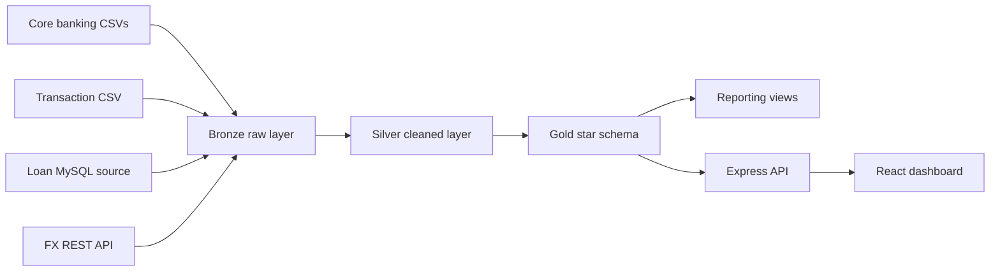

# Financial Data Warehouse Final Report

## 1. Introduction to the Business

This project designs a data warehouse for a synthetic retail banking organization. The organization manages customers, accounts, branches, banking transactions, foreign-exchange rates, loans, and loan payments.

Operational data is distributed across multiple sources. Customer, account, and branch master data are supplied as CSV files. Banking transactions are supplied as a separate CSV extract. Loan and payment data originate in a MySQL source database. Foreign-exchange rates are retrieved from a REST API and loaded into the warehouse.

The warehouse supports management questions about transaction volume, reporting-currency value, account balances, branch performance, currencies, loan exposure, payment behavior, overdue facilities, and upcoming loan maturities.

## 2. Tools and Technologies

| Technology | Use in this project |
| --- | --- |
| MySQL 8 | Source database and Bronze/Silver/Gold warehouse |
| SQL | DDL, ETL transformations, dimensional modelling, views, validation, and business analysis |
| Python | Foreign-exchange REST API extraction |
| Node.js and Express | Backend API and pipeline execution service |
| React and Vite | Warehouse operations dashboard |
| MySQL CLI or Workbench | Database implementation and demonstration |

## 3. Warehouse Architecture



Bronze stores source-shaped values. Silver parses dates, retains transaction source fields, transforms names and loan identifiers, and calculates reporting currency. Gold provides analytics-ready dimensions and facts.

## 4. Dimensional Model

### Dimensions

- `dim_date`: calendar date and reporting attributes.
- `dim_currency`: currency code and reporting-currency flag.
- `dim_branch`: branch identity and location attributes.
- `dim_customer`: customer identity and descriptive attributes.
- `dim_account`: account identity, owner, branch, type, opening date, and balance.
- `dim_loan_product`: loan product category, limits, and pricing.
- `dim_loan_officer`: warehouse-safe officer identifiers and role attributes.

### Facts and Grain

- `fact_transaction`: one row per banking transaction.
- `fact_exchange_rate`: one row per target currency and rate date.
- `fact_loan`: one row per loan facility.
- `fact_loan_payment`: one row per payment event.
- `fact_loan_application`: one row per customer portal loan application.
- `fact_loan_disbursement`: one row per loan disbursement.
- `fact_loan_repayment_schedule`: one row per scheduled installment.
- `fact_loan_collateral`: one row per collateral valuation.
- `fact_loan_guarantor`: one row per loan guarantor relationship.
- `fact_loan_fee`: one row per loan fee or penalty.
- `fact_loan_recovery_action`: one row per recovery action.
- `fact_loan_audit` and `fact_loan_payment_audit`: one row per source audit event.

The Gold physical schema is implemented in [gold_ddl.sql](../scripts/ddl/gold_ddl.sql). The full model documentation is in [DIMENSIONAL_MODEL.md](DIMENSIONAL_MODEL.md).

## 5. Implementation

The implementation sequence is:

1. Create `warehouse` and `banking_loan_source` databases.
2. Load the loan source database.
3. Create Bronze, routines, Silver, Gold, and reporting views.
4. Retrieve FX rates from the REST API.
5. Load Bronze source data.
6. Transform Bronze to Silver.
7. Refresh Gold dimensions and facts.
8. Run quality checks and business queries.

The backend exposes `POST /api/pipeline/run`, which executes the Bronze, Silver, and Gold load scripts in order. The React Run pipeline button calls this endpoint and refreshes the dashboard from MySQL.

## 6. Data Quality

The project includes checks for duplicate transaction IDs, duplicate fact grains, unresolved Gold dimension relationships, source-to-Gold row-count reconciliation, and loan relationship coverage. ETL stages write audit records to `warehouse.etl_run_log`.

Portal customers and branches are merged into the shared warehouse masters before Gold is built. Guarantor identity/contact fields and officer contact details stay in Bronze; Gold excludes those fields and operational notes.

## 7. Business Queries and Group Allocation

Each group member has four queries:

| Group member | File | Query numbers | Focus |
| --- | --- | --- | --- |
| Group 1 | [group_01_queries.sql](../scripts/queries/group_01_queries.sql) | Q01-Q04 | Transaction operations and channels |
| Group 2 | [group_02_queries.sql](../scripts/queries/group_02_queries.sql) | Q05-Q08 | Currency, accounts, and customers |
| Group 3 | [group_03_queries.sql](../scripts/queries/group_03_queries.sql) | Q09-Q12 | Branch and loan portfolio summaries |
| Group 4 | [group_04_queries.sql](../scripts/queries/group_04_queries.sql) | Q13-Q16 | Interest rates and payments |
| Group 5 | [group_05_queries.sql](../scripts/queries/group_05_queries.sql) | Q17-Q20 | Exposure, quality, and maturity risk |

The original combined query file remains available at [business_queries.sql](../scripts/queries/business_queries.sql).

## 8. Query Results

Results must be generated from the populated MySQL warehouse so that the report does not contain invented values. Run each group file or generate the combined output:

```powershell
mysql -u root -p warehouse < scripts/queries/group_01_queries.sql
mysql -u root -p warehouse < scripts/queries/group_02_queries.sql
mysql -u root -p warehouse < scripts/queries/group_03_queries.sql
mysql -u root -p warehouse < scripts/queries/group_04_queries.sql
mysql -u root -p warehouse < scripts/queries/group_05_queries.sql
mysql -u root -p warehouse < scripts/queries/business_queries.sql > docs/business_query_results.txt
```

For the final submission, attach `business_query_results.txt` or paste the result tables below each corresponding business question and explain the business implication.

## 9. Demonstration Steps

1. Start MySQL and configure `backend/.env`.
2. Create and load the warehouse using the documented SQL order.
3. Start the backend with `npm run dev` from `backend/`.
4. Start the dashboard with `npm run dev` from `visualization/`.
5. Open `http://127.0.0.1:5173`.
6. Run the pipeline from the dashboard.
7. Demonstrate overview metrics, pipeline health, transactions, loans, quality checks, and ETL history.
8. Present the 20 query results and their business interpretations.

## 10. Conclusion

The project provides a complete multi-source banking warehouse implementation with dimensional Gold modelling, repeatable ETL, quality controls, an API layer, and an operational React dashboard. The final demonstration must use a configured MySQL instance to generate the actual business-query result tables.
