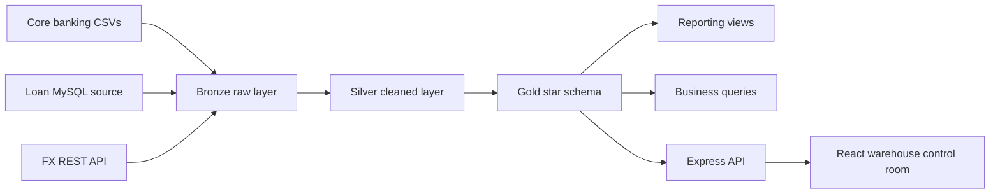

# Banking Data Warehouse Project Report

## 1. Business Introduction

This project designs an analytical data warehouse for a synthetic retail banking organization. The bank manages customers, accounts, branches, banking transactions, foreign-exchange activity, loans, and loan payments.

Operational systems produce different types of data: master data is delivered as CSV extracts, transactions are delivered as a separate CSV extract, loan data comes from a MySQL source database, and foreign-exchange rates come from a REST API. The warehouse combines these sources so analysts can compare activity across customers, accounts, branches, currencies, and time.

The main business goals are to:

- Monitor transaction activity and reporting-currency value.
- Compare account and branch performance.
- Understand currency exposure and exchange-rate coverage.
- Monitor loan balances, payments, overdue facilities, and maturity dates.
- Provide repeatable data-quality checks and auditable ETL runs.

## 2. Tools and Technologies

| Tool | Purpose |
| --- | --- |
| MySQL 8 | Source database, Bronze/Silver/Gold warehouse, views, routines, and queries |
| SQL | DDL, ETL transformations, dimensional modelling, validation, and analysis |
| Python | REST API extraction and exchange-rate loading |
| Node.js and Express | Backend API for warehouse reads and pipeline execution |
| React and Vite | Operations dashboard and interactive data views |
| REST API | Application interface between the dashboard and MySQL |
| MySQL Workbench or MySQL CLI | Database implementation and demonstration |

## 3. Warehouse Architecture

Bronze preserves source values. Silver applies typing, parsing, and transformation. Gold provides analytics-ready dimensions and facts. Reporting views simplify common application queries.

## 4. Dimensional Design

The Gold model uses conformed dimensions shared by analytical facts:

- `dim_date`: calendar attributes and date surrogate key.
- `dim_currency`: currency code and reporting-currency flag.
- `dim_branch`: branch master data.
- `dim_customer`: customer identity and descriptive attributes.
- `dim_account`: account, customer, branch, account type, opening date, and balance.
- `dim_loan_product`: loan product category, limits, and pricing.
- `dim_loan_officer`: source officer key and role attributes without contact details.

Fact grains are:

- `fact_transaction`: one row per source banking transaction.
- `fact_exchange_rate`: one row per exchange-rate currency and date.
- `fact_loan`: one row per loan facility.
- `fact_loan_payment`: one row per loan payment.
- `fact_loan_application`: one row per customer portal application.
- `fact_loan_disbursement`: one row per disbursement.
- `fact_loan_repayment_schedule`: one row per scheduled installment.
- `fact_loan_collateral`: one row per collateral valuation.
- `fact_loan_guarantor`: one row per guarantor relationship.
- `fact_loan_fee`: one row per assessed fee or penalty.
- `fact_loan_recovery_action`: one row per recovery action.
- `fact_loan_audit` and `fact_loan_payment_audit`: one row per source audit event.

The physical MySQL implementation is defined in [gold_ddl.sql](../scripts/ddl/gold_ddl.sql). The logical and physical model details are documented in [DIMENSIONAL_MODEL.md](DIMENSIONAL_MODEL.md).

## 5. ETL Implementation

The repeatable implementation order is:

1. Create the source loan database.
2. Create Bronze, Silver, Gold, routines, and reporting views.
3. Fetch exchange rates from the REST API.
4. Load Bronze source data.
5. Transform Bronze into Silver.
6. Refresh Gold dimensions and facts.
7. Run validation queries.

The Node API exposes the same process through `POST /api/pipeline/run`. ETL stages log start and success events in `warehouse.etl_run_log`. The React Run pipeline button invokes that endpoint and refreshes the dashboard.

## 6. Data Quality and Limitations

The warehouse includes duplicate, relationship, row-count, exchange-rate, and dimension-key checks. Portal customers and branches are merged into the shared warehouse masters. Guarantor identity/contact data and officer contact details are restricted to Bronze and omitted from Silver and Gold; operational notes are omitted from Gold.

The numeric results in a final submission must be generated from the populated MySQL instance. This repository does not hard-code analytical results into the report or dashboard.

## 7. Demonstration

Start MySQL and configure `backend/.env`. Start the backend with `npm run dev` from `backend/`, then start the React app with `npm run dev` from `visualization/`. Open `http://127.0.0.1:5173`, run the pipeline, inspect the Bronze/Silver/Gold status, review transactions and loans, and open the quality view.
